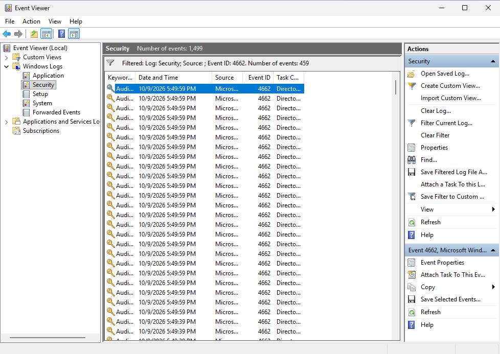
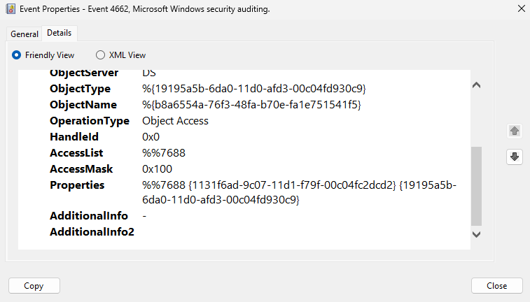

# DCSync Attack a Detekce v Active Directory

Tento zápis dokumentuje průběh simulovaného DCSync útoku v laboratoři, extrakci doménových hesel z databáze Active Directory a následné ověření detekčních logů v prohlížeči událostí Windows Serveru.

---

## 1. Získání doménových hesel (DCSync Attack)
Útok: Z Kali Linuxu jsem spustil nástroj secretsdump ze sady Impacket pod získanými administrátorskými přihlašovacími údaji:

`impacket-secretsdump lab.local/Administrator:'Heslo123'@192.168.10.2`
* **Princip**: Útok zneužívá legitimní rozhraní Microsoft DRSUAPI (Directory Replication Service). Kali Linux předstírá, že je dalším doménovým řadičem vyžadujícím replikaci adresáře.

* **Zisk**: Získán komplet obsah databáze NTDS.dit – NTLM hashe všech uživatelských i systémových účtů v doméně. Mezi nimi byl klíčový hash účtu krbtgt:

`krbtgt:502:aad3b435b51404eeaad3b435b51404ee:804d16f49175ff98977a2767e1423067:::`
(NTLM hash 804d16f49175ff98977a2767e1423067 představuje hlavní klíč k doméně a umožňuje případné vytvoření falešného Kerberos lístku – Golden Ticket).

---

## 2. Detekce a analýza v Event Vieweru (Blue Team)
* **Ověření v logách**: V Prohlížeči událostí (Event Viewer) na DC01 v deníku Security Log bylo zachyceno přibližně 500 událostí Event ID 4662 (An operation was performed on an object).

* **Vysvětlení množství logů**: Nástroj secretsdump čte databázi NTDS.dit po jednotlivých objektech a jejich atributech. Získání hesel z celého adresáře tak vygenerovalo samostatný auditní log pro každý dotázaný objekt během několika vteřin.

---

## 3. Klíčové indikátory útoku (Telemetrie Event ID 4662)

Zachycené události Event ID 4662 umožňují jednoznačnou identifikaci DCSync útoku na základě dvou hlavních znaků:

* **Subject (Žadatel)**: Log uvádí účet lab.local\Administrator. Replikaci AD běžně provádí pouze skryté účty doménových řadičů, nikoliv lidský uživatel.

* **Access Properties:** Přítomnost specifických GUID identifikátorů pro replikaci Active Directory:

`1131f6aa-9c07-11d1-f79f-00c04fc2dcd2` (DS-Replication-Get-Changes)

`1131f6ad-9c07-11d1-f79f-00c04fc2dcd2`(DS-Replication-Get-Changes-All)

---

## 4. Doporučení pro nápravu a detekci
Detekce anomální replikace: V SIEMu nastavit alert na Event ID 4662 obsahující replikační GUIDs v případě, že žadatel nekončí znakem $ (nejde o legitimní doménový řadič).

Principle of Least Privilege: Pravidelně auditovat, které účty mají v Active Directory přidělena práva Replicating Directory Changes.

Rotace hesla krbtgt: V případě podezření na provedení DCSync útoku provést dvojitou rotaci hesla účtu krbtgt, čímž se invalidují případně vytvořené Golden Tickety.

* **Závěr**: Scénář demonstruje sílu útoku DCSync, který nevyužívá softwarovou zranitelnost, ale zneužívá architekturu Active Directory. Přestože útok probíhá tiše po síti, zanechává v systému jasnou stopu v podobě série událostí Event ID 4662, které umožňují jeho spolehlivou detekci.