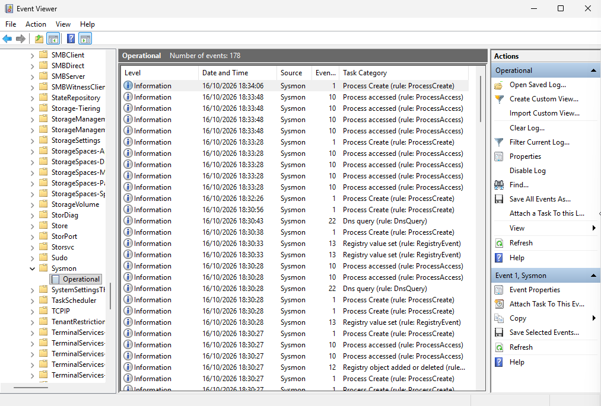

# LSASS Memory Dumping a Detekce v Sysmonu

Tento zápis dokumentuje simulaci útoku na lokální úložiště hesel ve Windows (proces LSASS) pomocí systémového nástroje, odhalení slepého místa v logování, aplikaci vlastního detekčního pravidla a analýzu falešných poplachů v SIEMu.

---

## 1. Útok a krádež hesel

- **Cíl:** Získat hesla a NTLM hashe z operační paměti procesu `lsass.exe`.
- **Útok:** Zneužili jsme z administrátorské příkazové řádky legitimní diagnostickou knihovnu Windows `comsvcs.dll`:
  ```cmd
  rundll32.exe C:\windows\System32\comsvcs.dll, MiniDump 800 C:\lsass.dmp full
  ```
  *(Poznámka: Windows Defender při zapnuté real-time ochraně tento pokus úspěšně zablokoval. Pro zisk souboru bylo nutné ochranu dočasně vypnout).*
- **Zisk:** Vytvořen soubor `lsass.dmp`, ze kterého lze (např. přes nástroj `pypykatz`) vyextrahovat hesla přihlášených uživatelů.

---

## 2. Identifikace slepého místa a úprava auditu

- **Slepé místo:** Při prvním pokusu Sysmon zachytil pouze samotné spuštění příkazu (Event ID 1). Událost přístupu do paměti (Event ID 10) chyběla, protože výchozí konfigurace Sysmonu ji z výkonnostních důvodů ignoruje.
- **Detekce:** Pro odhalení útoku bylo nutné přidat do souboru `sysmonconfig.xml` explicitní pravidlo pro sledování přístupu k `lsass.exe`:
  ```xml
  <ProcessAccess onmatch="include">
      <TargetImage condition="is">C:\Windows\system32\lsass.exe</TargetImage>
  </ProcessAccess>
  ```
- **Aplikace konfigurace:** Po spuštění `sysmon.exe -c sysmonconfig.xml` systém vygeneroval **Event ID 16** (Sysmon config state changed), což potvrdilo úspěšné načtení nové konfigurace.

---

## 3. Úspěšná detekce a False Positives v SIEMu

Po zopakování útoku Sysmon úspěšně zachytil a předal data do Wazuh SIEMu:

- **Zachycení útoku:** Vygenerován **Event ID 10 (Process Access)** potvrzující, že proces `rundll32.exe` četl paměť `lsass.exe`.
- **Wazuh Alert:** SIEM na událost zareagoval kritickým alertem **Level 12 (Rule 92900: Lsass process was accessed)**.
- **Falešné poplachy (False Positives):** Ukázalo se, že zavedené pravidlo je příliš široké. Wazuh kromě útoku začal detekovat i legitimní přístupy systémových procesů. V logu bylo zjištěno, že k LSASS přistupoval i Windows Defender* (`MsMpEng.exe`).

---

## 4. Doporučení pro nápravu a detekci

- **Úprava konfigurace Sysmonu:** Upravit XML konfiguraci Sysmonu tak, aby obsahovala výjimky pro známé a digitálně podepsané systémové procesy (např. Defender), čímž zamezíme zahlcení falešnými poplachy.
- **LSA Protection (RunAsPPL):** Zapnout v registrech ochranu LSA. Proces LSASS poběží ve striktně chráněném režimu a zabrání číst svou paměť i procesům s právy administrátora.
- **Attack Surface Reduction (ASR):** Mít aktivní ASR pravidla ve Windows Defenderu blokující zneužití podobných praktik (v tomto případě Defener poznal známou praktiku a napsal že se jedná o `HackTool:Win32/DumpLsass.H`).

**Závěr:** Útok demonstroval riziko zneužití legitimních nástrojů v systému. Z obranného hlediska simulace ukázala, že samotné nasazení Sysmonu bez kvalitního konfiguračního profilu neposkytuje dostatečnou viditelnost a plošné logování bez výjimek vede k falešným poplachům.