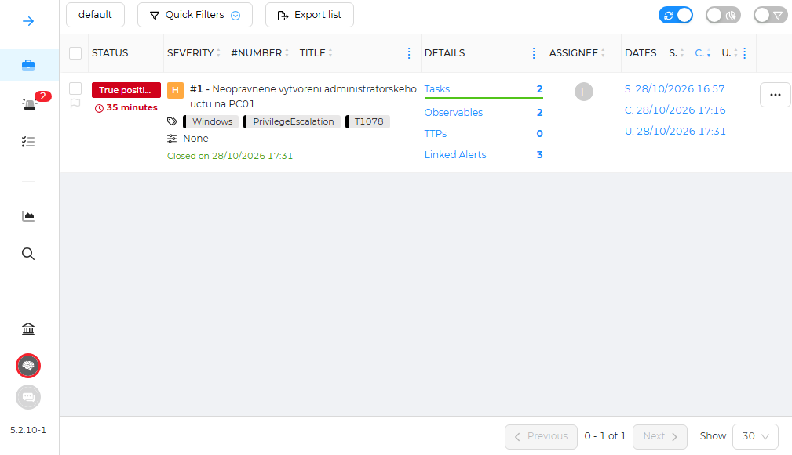

# Shuffle a TheHive 

Tento zápis dokumentuje stavbu a zprovoznění serveru s Shuffle a TheHive, simulaci neoprávněné eskalace práv na Windows endpointu, automatické zpracování alertů a kompletní životní cyklus vyšetřování incidentu v TheHive.

---

## 1. Architektura a Orchestrace (Shuffle SOAR)

- **Infrastruktura:** Ubuntu Server hostující v Docker kontejnerech **Shuffle SOAR** a **TheHive**. Jako testovací endpoint slouží stanice **Windows 11 (PC01)**.
- **Řetězení uzlů a tok událostí (Workflow):** Události jsou zpracovávány sekvenčně v rámci jednoho automatizovaného řetězce:
  ```text
  Wazuh - Webhook - HTTP Node (TheHive API) - HTTP Node (Discord Webhook)
  ```
  1. **Detekce:** Wazuh Agent na PC01 zachytí bezpečnostní událost ve Windows Event Logu.
  2. **Předání:** Vlastní integrace ve Wazuhu (`custom-shuffle`) odešle JSON payload přes Webhook do Shufflu.
  3. **Orchestrace & Ticketing:** Shuffle zpracuje událost a přes API vytvoří nový alert v TheHive.
  4. **Notifikace:** Po založení ticketu Shuffle okamžitě odešle strukturovaný JSON payload na Discord Webhook

---

## 2. Správa incidentů

- **Falešný poplach (False Positive):** Událost čtení paměti LSASS aplikací `MsMpEng.exe` jsem uzavřel jako legitimní skenování antiviru bez vytváření případu.
- **Povýšení na Case (True Positive):** Detekci *"Administrators Group Changed"* (vytvoření lokálního účtu `NovyUcet` a povýšení do skupiny administrators) jsem vyhodnotil jako reálnou hrozbu a povýšil z Alertu na Case. U něj jsem si pak zkusil vytvořit **Observations** a **Tasks**, které jsem nasledně provedl a případ ukončil. 



---

**Závěr:** Projekt úspěšně demonstroval plně funkční end-to-end cyklus SOC dohledu. Propojení SIEM, SOAR a správy incidentů s okamžitou notifikací na Discord výrazně zkracuje čas reakce a poskytuje strukturované prostředí pro správu incidentů.