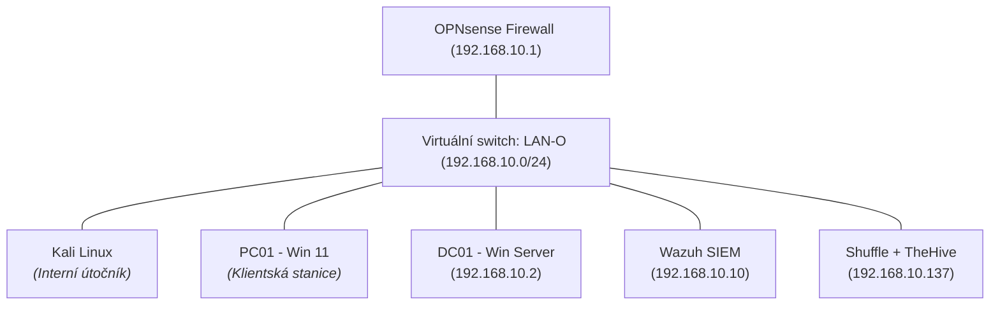

# Kyber Lab – Struktura a konfigurace

## Přehled projektu
Cílem projektu je vytvoření plně izolovaného virtuálního prostředí pro praktické testování kybernetických útoků, analýzu logů a vývoj vlastních detekčních pravidel v SIEM platformě Wazuh. 

Infrastruktura simuluje reálné prostředí s doménou Active Directory, centrálním směrováním přes dedikovaný firewall a sběrem bezpečnostních logů.

---

## Síťová topologie a uzly

Všechny virtuální stroje včetně kali, simulující hrozbu uvnitř sítě, běží v izolovaném VMware LAN segmentu `LAN-O` (`192.168.10.0/24`). Přístup do vnější sítě je řízen firewallem.

| Zařízení | OS | IP adresa | Přidělení IP | Role v infrastruktuře |
| :--- | :--- | :--- | :--- | :--- |
| **OPNsense** | FreeBSD / OPNsense | `192.168.10.1/24` | Statická | Firewall, výchozí brána, DHCP server, DNS query forwarding |
| **DC01** | Windows Server 2025 | `192.168.10.2/24` | Statická | Doménový řadič (`lab.local`), DNS server pro doménu |
| **Wazuh-SIEM** | Ubuntu 26.04  | `192.168.10.10/24` | Statická | Centrální SIEM |
| **PC01** | Windows 11 Pro | `DHCP Lease` | DHCP | Klientská doménová stanice |
| **Kali** | Kali Linux | `DHCP Lease` | DHCP | Útočník v interním segmentu |
| **Shuffle + TheHive** | Ubuntu 26.04.01 | 192.168.10.137/24 | Statická | SOAR + Incident Response |



## Konfigurace infrastruktury 
1. Směrování a překlad jmen (DNS)
Výchozí brána a DHCP: OPNsense spravuje DHCP rozsah pro klientské a útočné stroje.

Domain Name Resolution: Pro zajištění stability Active Directory je v OPNsense (Unbound DNS) nakonfigurován Query Forwarding pro zónu lab.local směrovaný přímo na IP adresu 192.168.10.2 (DC01). Ostatní internetové dotazy řeší firewall standardním překladem.

2. Správa domény (Active Directory)
Byla vytvořena doména lab.local na Windows Server 2025 (DC01).

Klientská stanice PC01 (Windows 11) byla úspěšně zařazena do doménového prostředí.

Automatické aktualizace Windows Update byly na všech Windows instancích deaktivovány přes systémové služby a registry, aby se předešlo znehodnocení snapshotů a neočekávaným restartům během testování.

## Telemetrie a sběr bezpečnostních událostí
1. Endpoint Detection (Sysmon)
Na DC01 i PC01 byl nasazen nástroj Microsoft Sysmon. Tento krok zajišťuje dohled nad chováním operačního systému:


2. Integrace se SIEM (Wazuh)
Na Windows strojích je nasazen Wazuh Agent komunikující se serverem přes port TCP 1514.

V konfiguračním souboru ossec.conf byl aktivován kanál pro Sysmon:

```xml
XML
<localfile>
  <location>Microsoft-Windows-Sysmon/Operational</location>
  <log_format>eventchannel</log_format>
</localfile>
```
Wazuh server má otevřený port UDP 514 pro příjem síťových Syslog událostí z firewallu OPNsense.

---

**Poznámky**
* Později přidán Ubuntu server a na něj nainstalován Docker a následně Shuffle a TheHive
